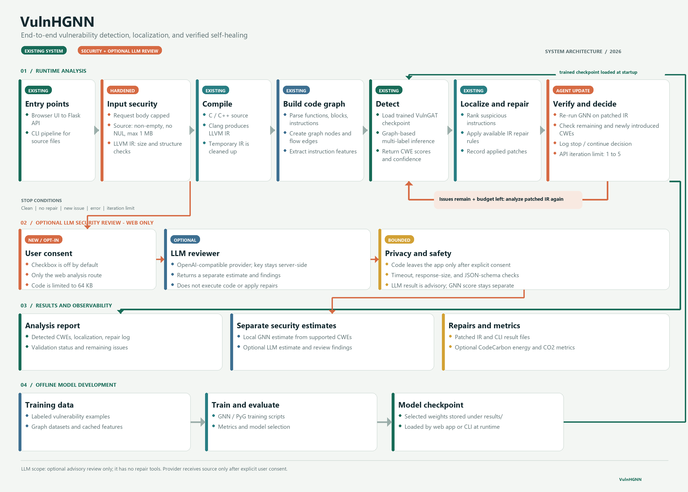
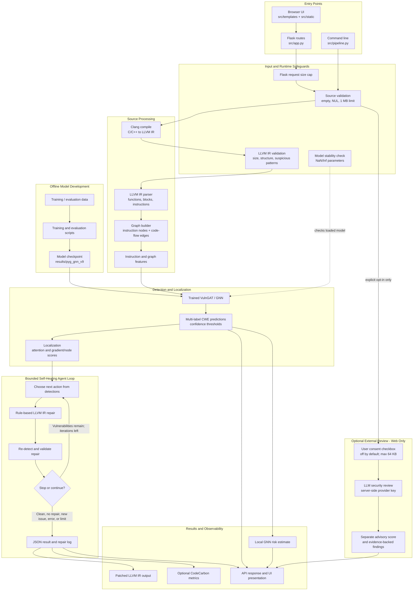

# VulnHGNN Architecture



## System Overview

VulnHGNN accepts C/C++ source through either the Flask web application or the command-line pipeline. The source is checked, compiled to LLVM IR, parsed into function-level representations and graphs, and scored by the trained VulnGAT model. Detection results can be localized and passed to the IR repair engine. A bounded feedback loop re-runs detection on the patched IR and reports the outcome.

The web interface also offers a separate, optional LLM security review. It is off by default, requires explicit user consent, and sends source only to a provider configured by the server operator. Its advisory score and findings are kept separate from the local GNN result; the LLM cannot invoke repair tools.



## Runtime Flow

1. **Submit source:** A user submits C/C++ in the web UI or selects a file through the CLI.
2. **Apply input safeguards:** The Flask app imposes a request-body cap. Shared source validation rejects empty text, NUL bytes, and source larger than 1 MB before it is written for compilation. The healing loop repeats source validation before invoking the compiler, protecting the CLI path as well.
3. **Compile and validate IR:** Clang produces LLVM IR. The security module checks the IR's size, basic structure, function count, brace balance, and configured suspicious assembly patterns.
4. **Represent code as a graph:** The IR parser extracts functions, basic blocks, and instructions. Graph-building and feature code converts these into model input.
5. **Detect and localize:** The trained GNN predicts supported CWE classes. Localization scores instructions associated with detected classes.
6. **Repair and verify:** The repair engine applies available rule-based IR patches. The validation stage runs GNN re-detection and checks whether new vulnerability classes appeared.
7. **Optional LLM review:** In the web UI only, a user may explicitly opt in to send source no larger than 64 KB to the configured provider. The provider returns a separate advisory score and findings; the code is not executed and the LLM cannot apply repairs. Without provider configuration or consent, no source is sent.
8. **Decide and return artifacts:** The existing repair loop stops when no vulnerabilities remain, no repair is available, validation identifies a newly introduced issue, an error occurs, or the iteration limit is reached. API callers may request 1-5 iterations; the default is 5. Each iteration records an `agent_decision`. Reports, patched IR, the local GNN estimate, optional LLM review, and optional carbon metrics are returned separately.

## Agent Decision Cycle

```mermaid
sequenceDiagram
    participant User
    participant Guard as Input Security
    participant Loop as Healing Controller
    participant GNN as VulnHGNN Model
    participant Loc as Localization
    participant Fix as IR Repair Rules
    participant Check as Repair Validator

    User->>Guard: Submit source code
    Guard->>Guard: Check type, empty/NUL, and size
    Guard->>Loop: Accept valid source
    Loop->>GNN: Detect vulnerabilities in current IR
    GNN-->>Loop: CWE classes and confidence
    alt No vulnerabilities
        Loop-->>User: Stop: clean
    else Vulnerabilities detected
        Loop->>Loc: Score relevant instructions
        Loc-->>Loop: Ranked instructions
        Loop->>Fix: Apply available repair rules
        Fix-->>Loop: Patched IR and patch log
        Loop->>Check: Re-run detection and check for new CWEs
        Check-->>Loop: Remaining/new CWEs and validation result
        alt Clean and no new vulnerabilities
            Loop-->>User: Stop: repair verified
        else Repair unavailable, validation risk, error, or iteration limit
            Loop-->>User: Stop with status and iteration log
        else Issues remain and iteration budget remains
            Loop->>GNN: Analyze patched IR in next iteration
        end
    end
```

**LLM scope:** The optional LLM is a source-code reviewer, not an autonomous repair agent. It has no tools and cannot execute code or change files. The bounded healing loop remains deterministic and uses the GNN, repair rules, and validator; its `agent_decision` field records loop decisions.

## Component Map

| Concern | Main implementation |
|---|---|
| Web interface and API | `src/app.py`, `src/templates/`, `src/static/` |
| Optional external LLM review | `src/llm_security_review.py` |
| CLI orchestration and result files | `src/pipeline.py` |
| Source and LLVM IR security checks; model diagnostics | `src/security.py` |
| Compile, detect, localize, repair, and validate iteration loop | `src/feedback_loop.py` |
| Model loading and predictions | `src/predict.py`, `src/pyg_model.py` |
| LLVM IR parsing and graph construction | `src/ir_parser.py`, `src/pyg_dataset.py` |
| Vulnerability localization | `src/localization.py` |
| IR repair | `src/ir_healer.py` |
| Repair verification and GNN re-detection | `src/validation.py` |
| Model training and evaluation | `src/train_pyg.py`, `src/train_gnn.py`, related training scripts |
| Carbon tracking | `src/carbon_tracker.py` |
| Checkpoints and generated reports | `results/`, `data/` |

## Existing Capabilities and Recent Additions

| Area | Existing project | Recent addition |
|---|---|---|
| Detection workflow | Flask UI/API and CLI; C/C++ compilation; graph-based multi-label CWE detection | Shared source validation now runs before source compilation in API and healing-loop paths |
| Input security | Flask request-size cap and LLVM IR validation | Source text rejects empty input and NUL bytes and has a 1 MB cap |
| Self-healing | Rule-based IR repair followed by GNN re-detection and new-CWE checks | Iteration output records why the bounded loop continues or stops |
| Resource control | Healing loop has an iteration limit | API validates `max_iterations` as an integer from 1 through 5 |
| Model/runtime checks | Model stability helper and CLI pipeline stability check | No claim that model-health checks are applied to every web request |
| Web runtime | Local Flask UI/API | Flask debug mode is disabled when started directly |
| Optional LLM review | Not present | User-opted-in provider review with separate score; disabled unless configured |

## Security Scope

These safeguards reduce accidental or oversized input and provide basic validation before parsing and compilation. The optional LLM path sends source outside the application only after explicit user consent, only when provider credentials are configured, and only for inputs up to 64 KB. Review the provider's retention and training policies before sending proprietary code. LLM results are untrusted advice, not proof of security. These safeguards do not make the application a hardened multi-user service by themselves. If deployed beyond a local demo, add authentication and authorization, rate limiting, isolated/time-limited compiler execution, restricted filesystem access, production-grade server configuration, and operational logging/monitoring.
